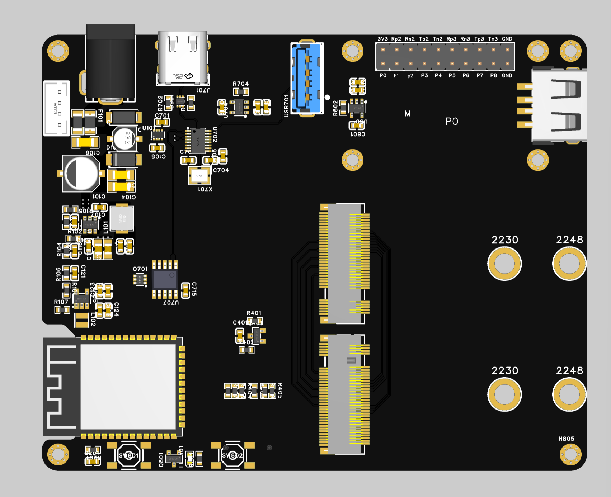
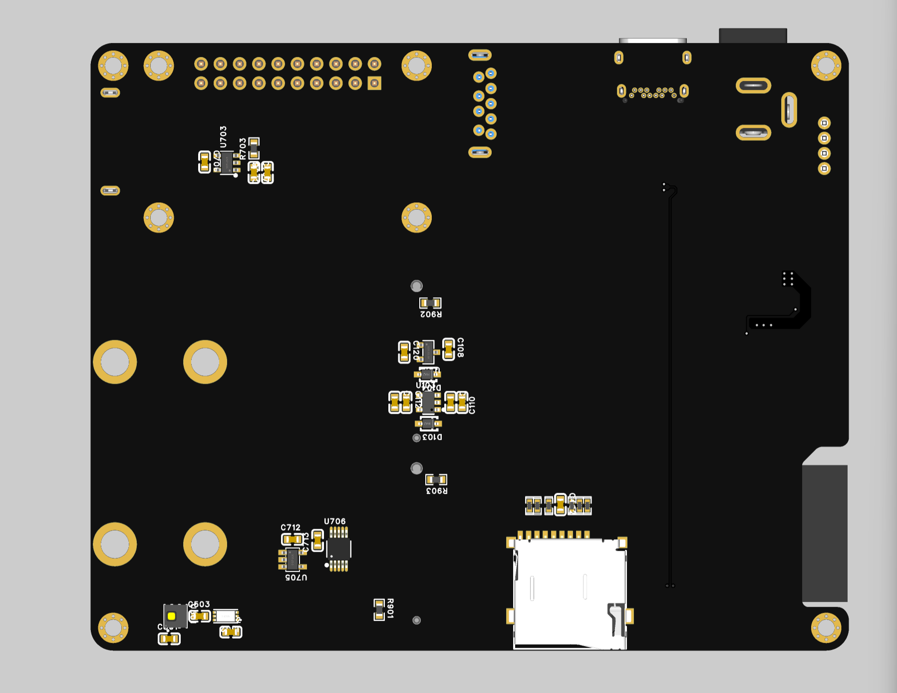

# AxiomKey Fabric

**AxiomKey Fabric** is an open modular hardware platform built around customized M.2 Key M and Key B connectors. It combines a reusable ESP32-S3 baseboard, interchangeable MKEY compute modules, and interchangeable BKEY sensor modules for rapid development across MCU, SoC, FPGA, sensing, gateway, and edge-control applications.

> The project reuses M.2 connector mechanics with a custom electrical pin map. It is **not electrically compatible** with standard SSD, WWAN, PCIe, or computer M.2 slots.

[中文说明](README.zh-CN.md)

## Platform Architecture

The first baseboard revision uses an ESP32-S3 as the platform management controller. It provides gateway services, MKEY/BKEY insertion detection, power management, onboard environmental temperature and humidity monitoring, TF-card black-box logging, USB Hub connectivity, switching, and protection.

MKEY is the replaceable heterogeneous compute or acceleration module. It may use an MCU, SoC, or FPGA from different vendors. BKEY is the replaceable sensor module.

### MKEY USB Role Switching

MKEY controls the role of its own USB controller:

- **Device mode:** MKEY USB is routed to a downstream port of the baseboard USB Hub, whose upstream Host is the external computer.
- **Host mode:** MKEY USB is disconnected from the Hub and routed to the adjacent USB-A Host receptacle.
- The two routes are mutually exclusive. The released design must define switch truth tables, VBUS source direction, discharge, over-current protection, back-feed prevention, and safe behavior during reset or unpowered states.

## Hardware Preview

| Baseboard V1 front | Baseboard V1 back |
| --- | --- |
|  |  |

## Repository Layout

~~~text
.github/                 GitHub workflows and contribution templates
3D_Print/                Enclosures, fixtures, panels, and printable parts
AI_Knowledge_Base/       Reviewed context for AI-assisted engineering
DOC/                     Architecture, interface notes, and release process
FW/                      Baseboard, module, library, example, and test firmware
HW/                      Baseboard, MKEY, BKEY, shared CAD, pin maps, and outputs
Tools/                   Repository validation and engineering utilities
~~~

## Interface Sources of Truth

- MKEY pin map: [`HW/MKEY/Pinmaps/MKEY_IO_MAP.xlsx`](HW/MKEY/Pinmaps/MKEY_IO_MAP.xlsx)
- BKEY pin map: [`HW/BKEY/Pinmaps/BKEY_IO_MAP.xlsx`](HW/BKEY/Pinmaps/BKEY_IO_MAP.xlsx)
- BKEY visual reference: [`HW/BKEY/Images/bkey-pinout.png`](HW/BKEY/Images/bkey-pinout.png)
- Interface overview: [`DOC/interface-overview.md`](DOC/interface-overview.md)

The released spreadsheets are authoritative for connector assignments. Any pin-map change must update the affected schematic, documentation, compatibility notes, AI context, and changelog in the same revision.

## Engineering Rules

- Never route MKEY to BKEY solely by equal physical pin numbers; route by documented function, pair identity, and polarity.
- The MKEY interface is fixed unless an explicit interface revision is approved.
- The external computer is the USB Hub upstream Host. MKEY reaches the Hub only in Device mode.
- MKEY Host mode must isolate the Hub path before connecting to the USB-A Host receptacle and sourcing VBUS.
- `3V3_B`, `3V3_LDO0`, and `VIO_B` are separate domains unless a released schematic explicitly joins them.
- Extended power contacts support future hot-plug work but do not replace inrush, ESD, sequencing, reverse-current, and fault testing.
- Every module must declare voltage, maximum power, supported interfaces, directions, speed limits, and required PHYs.

## Getting Started

1. Read [`DOC/architecture.md`](DOC/architecture.md) and [`DOC/interface-overview.md`](DOC/interface-overview.md).
2. Review both pin-map workbooks before creating a module schematic.
3. Place editable hardware sources under the appropriate `HW/*/CAD/` directory.
4. Place firmware under `FW/Baseboard/`, `FW/MKEY/`, `FW/BKEY/`, or shared code under `FW/Library/`.
5. Run `pwsh ./Tools/validate-repo.ps1` before committing.

## Licensing

- Firmware, software, and tools: Apache License 2.0 - [`LICENSE`](LICENSE)
- Hardware and mechanical designs: CERN-OHL-S-2.0 - [`LICENSE-HARDWARE`](LICENSE-HARDWARE)
- General documentation: CC-BY-4.0 - [`LICENSE-DOCS`](LICENSE-DOCS)

See [`LICENSING.md`](LICENSING.md) for scope details.
