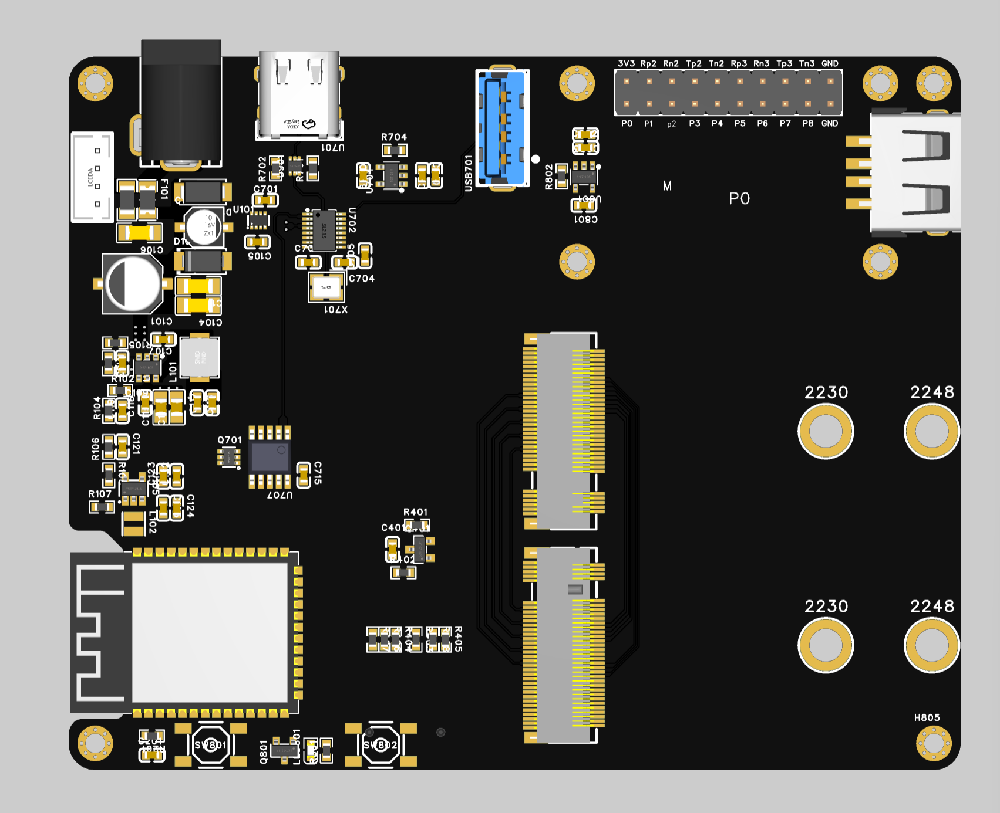
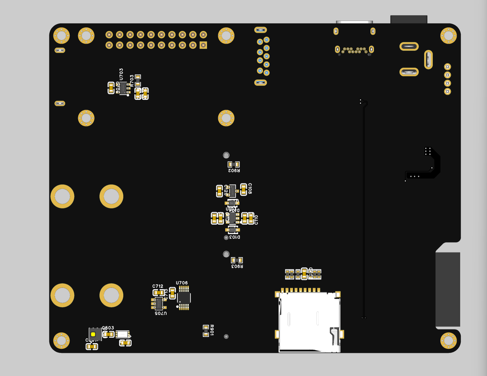

# AxiomKey Fabric

**AxiomKey Fabric** 是一个基于魔改 M.2 Key M / Key B 连接器的开放式模块化硬件开发平台。平台由可复用的 ESP32-S3 底板、可替换 MKEY 异构核心板，以及可替换 BKEY 传感器板组成，适用于 MCU、SoC、FPGA、传感器、网关和边缘控制项目的快速开发。

> 本项目仅复用 M.2 连接器的机械形态，并采用自定义电气 PINMAP；它与标准 SSD、WWAN、PCIe 或电脑 M.2 插槽**不具备电气兼容性**。

[English README](README.md)

## 平台架构

第一版底板使用 ESP32-S3 作为平台管理主控，承担网关、MKEY/BKEY 插入检测、电源管理、板载环境温湿度采集、TF 卡黑匣子记录、USB Hub、切换和保护功能。

MKEY 是可替换的异构计算或加速核心板，可采用不同厂家的 MCU、SoC 或 FPGA；BKEY 是可替换传感器板。

### MKEY USB 身份切换

MKEY 控制自身 USB 控制器的角色：

- **Device/从机模式：** MKEY USB 接入底板 USB Hub 的一个下游端口，Hub 上游 Host 为外部电脑。
- **Host/主机模式：** MKEY USB 与 Hub 断开，切换到旁边的 USB-A Host 接口。
- 两条路径必须互斥。正式设计必须定义切换真值表、VBUS 供电方向、放电、过流保护、防反灌，以及复位或掉电期间的安全默认状态。

## 硬件预览

| 第一版底板正面 | 第一版底板背面 |
| --- | --- |
|  |  |

## 仓库结构

~~~text
.github/                 GitHub 工作流和协作模板
3D_Print/                外壳、夹具、面板及可打印结构件
AI_Knowledge_Base/       经审核的 AI 辅助工程知识库
DOC/                     架构、接口说明和发布流程
FW/                      底板、模块、公共库、示例和测试固件
HW/                      底板、MKEY、BKEY、公共 CAD、PINMAP 和生产文件
Tools/                   仓库校验与工程工具
~~~

## 接口权威文件

- MKEY PINMAP：[HW/MKEY/Pinmaps/MKEY_IO_MAP.xlsx](HW/MKEY/Pinmaps/MKEY_IO_MAP.xlsx)
- BKEY PINMAP：[HW/BKEY/Pinmaps/BKEY_IO_MAP.xlsx](HW/BKEY/Pinmaps/BKEY_IO_MAP.xlsx)
- BKEY 引脚示意图：[HW/BKEY/Images/bkey-pinout.png](HW/BKEY/Images/bkey-pinout.png)
- 接口总览：[DOC/interface-overview.md](DOC/interface-overview.md)

正式发布的表格是连接器定义的权威来源。任何 PINMAP 变更都必须在同一版本中同步修改原理图、兼容性说明、文档、AI 知识库和变更记录。

## 核心工程规则

- MKEY 与 BKEY 必须按功能、差分对身份和极性连接，不能按相同物理 Pin 号直接连接。
- MKEY 接口已经确定，除非明确批准接口版本升级，否则不得修改。
- 外部电脑是 USB Hub 的上游 Host；MKEY 只有在 Device 模式下接入 Hub。
- MKEY 切换为 Host 模式时，必须先隔离 Hub 路径，再连接 USB-A Host 口并提供 VBUS。
- `3V3_B`、`3V3_LDO0` 和 `VIO_B` 是独立电源域，除非正式原理图明确连接。
- 延长电源触点只为未来热插拔兼容提供基础，仍需验证浪涌、ESD、时序、反向电流和故障能量。
- 每个模块必须声明电压、最大功耗、支持接口、方向、速率限制和 PHY 要求。

## 开始开发

1. 阅读 [DOC/architecture.md](DOC/architecture.md) 和 [DOC/interface-overview.md](DOC/interface-overview.md)。
2. 绘制模块原理图前，先核对两份 PINMAP 表格。
3. 可编辑硬件源文件放入相应的 `HW/*/CAD/` 目录。
4. 固件分别放入 `FW/Baseboard/`、`FW/MKEY/`、`FW/BKEY/`，公共代码放入 `FW/Library/`。
5. 提交前运行 `pwsh ./Tools/validate-repo.ps1`。

## 许可证

- 固件、软件和工具：Apache License 2.0 - [LICENSE](LICENSE)
- 硬件和机械设计：CERN-OHL-S-2.0 - [LICENSE-HARDWARE](LICENSE-HARDWARE)
- 通用文档：CC-BY-4.0 - [LICENSE-DOCS](LICENSE-DOCS)

适用范围详见 [LICENSING.md](LICENSING.md)。
